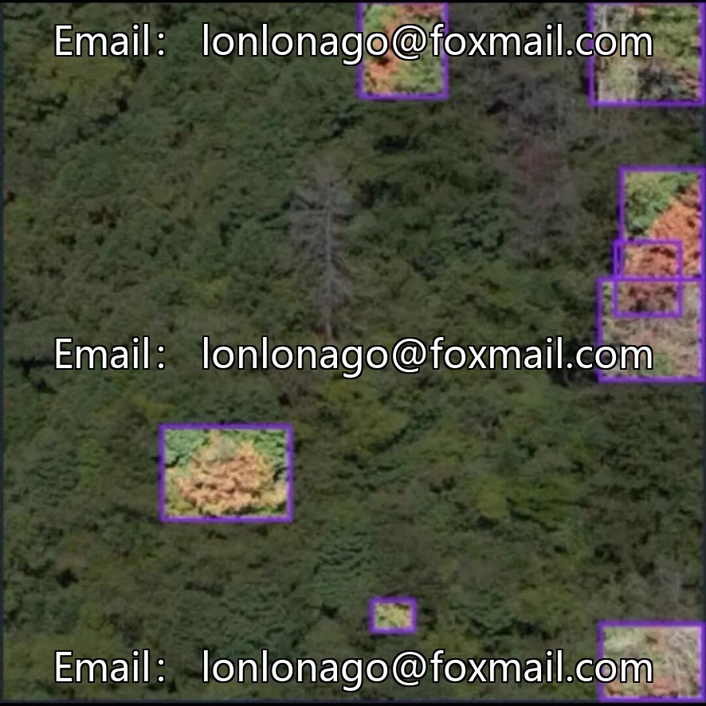
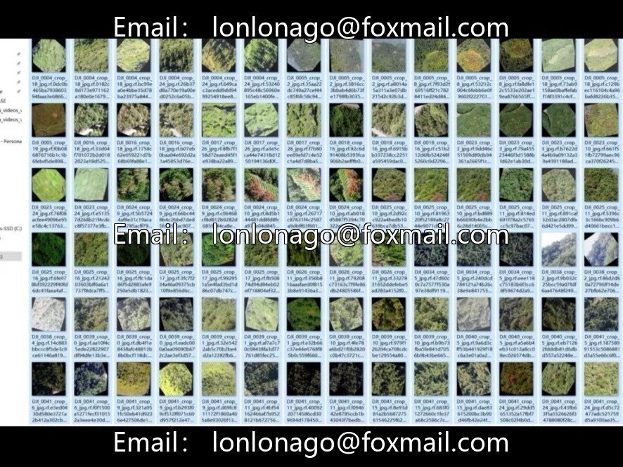
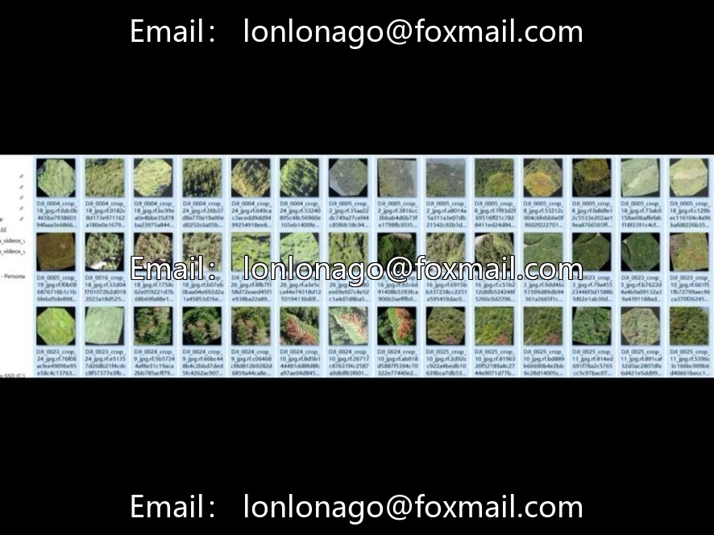

# YOLO Pine Disease (Pine Wilt) UAV Detection Dataset, 7011 images without

## Body

YOLO Pine Disease (Pine Wilt) Drone Detection Dataset, 7011 drone aerial images with native YOLO annotation format, accompanied by data.yaml configuration file. The dataset is pre-segmented into train/valid folders for immediate use, compatible with YOLOv5/v8 and other full series YOLO algorithms.

The dataset contains only one class: diseased (pine wilted trees), aimed at forest area drone aerial photography for disease identification tasks, suitable for smart forestry and intelligent forest inspection projects.

The dataset consists of 7011 images in the native YOLO annotation format, with a data.yaml configuration file already edited. The train/valid folders have been pre-partitioned, ready for immediate use, and is compatible with all series of YOLO algorithms including YOLOv5/v8.

Data Augmentation: Mosaic, MixUp+ simulates variable light angles to enhance model generalization.

Virtual materials, once sold, are non-refundable.

Interested friends, click "I want".

## Images

## Payment

Here is a pay link on Stripe ( https://buy.stripe.com/3cs8yP7sY87d0vu9AB ). Please contact me lonlonago@foxmail.com after funding $89, and I will send you a complete data files , thank you!

